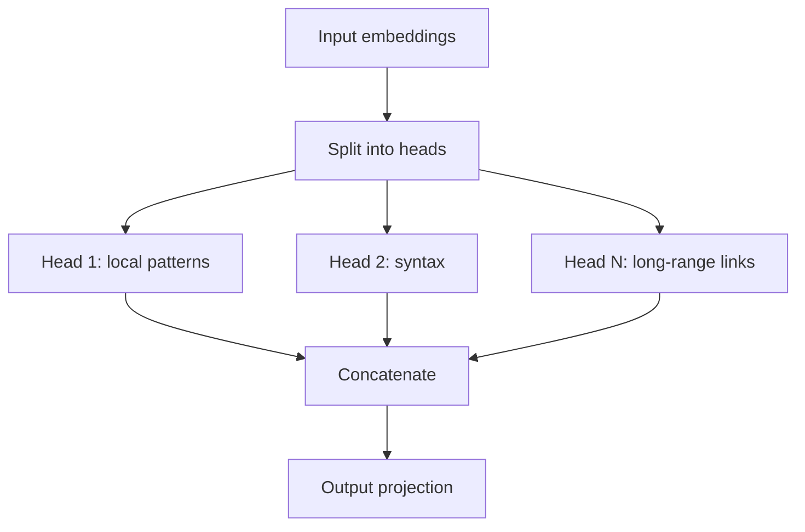

Attention is one of those ideas that sounds complicated until you find the right analogy, and then it sounds obvious. These are the notes I wish I had when I started reading about transformers.

## The problem with recurrence

Before attention, sequence models processed tokens one at a time. A recurrent network carried a hidden state from step to step, compressing everything it had seen into a fixed-size vector. This worked, but it had two costs: it was hard to parallelise, and long-range dependencies tended to fade.

Attention removes the bottleneck. Instead of forcing every token through a single running state, it lets each position look directly at every other position and decide what is relevant.

## Queries, keys, and values

The standard explanation uses a library. Each token asks a question (its **query**), every token advertises what it contains (its **key**), and the match between them determines how much of each **value** gets pulled in.

Formally, scaled dot-product attention is:

$$
\text{Attention}(Q, K, V) = \text{softmax}\left(\frac{QK^\top}{\sqrt{d_k}}\right)V
$$

The scaling factor $\sqrt{d_k}$ matters. Without it, dot products grow with dimension, the softmax saturates, and gradients become tiny. Dividing by the square root keeps the logits in a reasonable range.

## Multiple heads

A single attention operation produces one weighted average. Multiple heads let the model run several of these in parallel, each with its own learned projections.

The heads are not assigned roles by hand. The hope is that gradient descent discovers useful specialisations on its own, and in practice it often does.

## Why it works

Three properties explain most of attention's success:

1. **Parallelism.** All positions are processed at once, which maps well onto modern accelerators.
2. **Short paths.** Any two tokens are one operation apart, so information does not have to survive a long chain of updates.
3. **Learned weighting.** The model decides relevance from data rather than relying on a fixed window.

## What it does not solve

Attention is not free. Its cost grows quadratically with sequence length, which is why long-context models invest heavily in efficient variants. It also does not give the model memory in any persistent sense; context is still bounded by what fits in the window.

Understanding the mechanism is useful, but it is only one layer. The rest of the transformer — normalisation, residual streams, feed-forward blocks, and the training objective — matters just as much.
