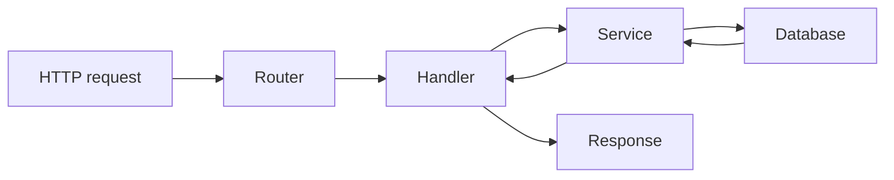

Most of the code I work with was written by someone else. Sometimes that someone is a stranger, sometimes a teammate, and sometimes a past version of me with different priorities and a worse memory. Getting oriented quickly is a skill, and like most skills it improves with a routine.

## Start at the edges

Do not begin at `main`. Begin where the program meets the outside world: routes, CLI commands, event handlers, or exported functions. These are the entry points, and they tell you what the system is *for* before you drown in how it works.

A useful first pass is to list the entry points and write one sentence for each:

- What triggers it?
- What does it return or change?
- What does it depend on?

That list is often enough to sketch the architecture.

## Follow one path end to end

Pick the most common operation and trace it from entry point to storage and back. Read every function on the way, but do not try to understand every branch. The goal is a spine you can hang later details on.

Once you have one working path, the rest of the codebase becomes variations on a theme.

## Read the tests as documentation

Tests are the only part of a codebase that states intended behaviour explicitly. They also tell you what the authors were afraid of breaking. A test suite is usually a better introduction than a README, because it cannot silently drift out of date without failing.

Start with the tests for the path you just traced. They will confirm your understanding and reveal edge cases you would have missed.

## Use the tools, but sparingly

Search and navigation tools are essential, but they can also keep you at the surface. Jumping from definition to definition feels productive while building very little understanding.

A better rhythm is to read a full file, then search for one specific term. Alternate between depth and breadth instead of doing either exclusively.

## Keep a map

I keep a scratch file while exploring. It contains the entry points, the main data structures, and a list of questions. The questions are the most valuable part, because they turn confusion into something I can resolve deliberately.

By the end of a day, the map is usually messy and half wrong. That is fine. The act of writing it is what turns a pile of files into a system you can reason about.
