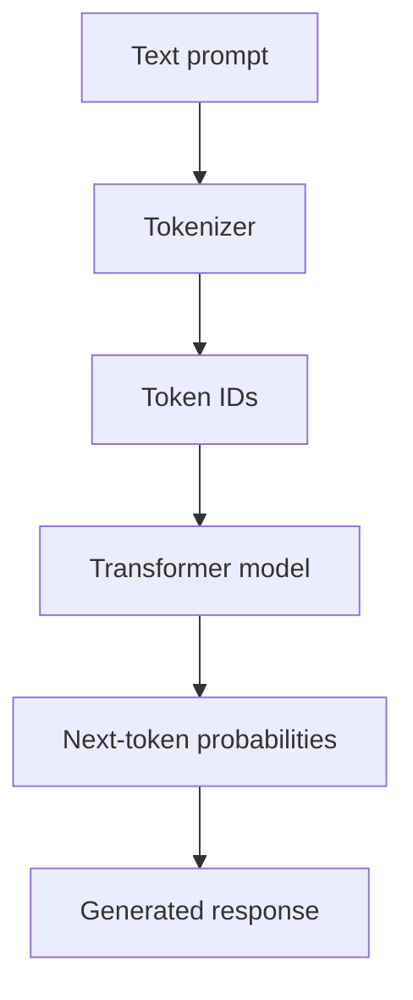

Large language models can feel almost mysterious from the outside. You give them a prompt, and they produce a response that can explain, summarize, translate, or write code.

But underneath that experience is a fairly understandable set of ideas: tokens, numerical representations, neural networks, and a training process that gradually shapes a model's behaviour.

## A simplified view

A language model receives a sequence of tokens and estimates what token is likely to come next. Repeating this process allows it to generate longer sequences.



## The central idea

At a high level, an autoregressive language model estimates:

$$
P(x_1, x_2, \ldots, x_n) = \prod_{i=1}^{n} P(x_i \mid x_1, \ldots, x_{i-1})
$$

This is only the beginning of the story. The interesting part is how the model learns useful representations and uses attention to relate different parts of a sequence.

## A small code example

```python
def greet(name: str) -> str:
    return f"Hello, {name}!"

print(greet("world"))
```

There is a lot more to unpack, and that's exactly what this publication is for: understanding complicated ideas one layer at a time.
